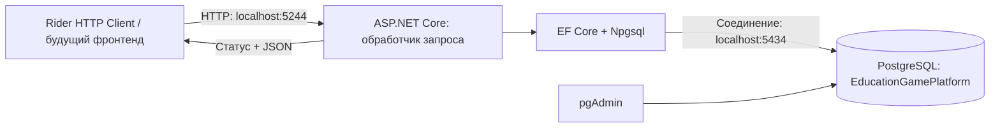
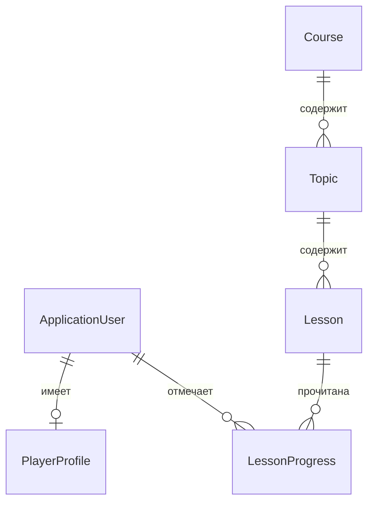

# Как устроен твой бэкенд

> Учебный разбор первоначального каркаса от 10 октября 2026 года. В нём сохранено объяснение того этапа,
> когда игровых операций ещё не было. С 17 октября бои, QTE, награды, разряды и фронтенд уже реализованы;
> актуальные изменения и файлы описаны в [разборе интеграции](trials-and-integration.md) и [карте API](api-map.md).

Это руководство по текущему коду EducationGamePlatform для человека, который уже немного знает массивы и циклы, но только начинает изучать C#. Сначала прочитай разделы 1–4, затем пройди запрос профиля в разделе 5. Остальные части можно читать по мере обучения. Порядок занятий и видео находятся в [плане обучения](learning-path.md).

Объяснения относятся к состоянию проекта на 10 октября 2026 года. Примеры с пометкой «учебный» показывают отдельную идею; их не нужно вставлять в приложение целиком.

## 1. Что приложение делает сейчас

Уже можно зарегистрироваться, войти, получить свой профиль, открыть опубликованные курсы, темы и лекции, отметить лекцию прочитанной и выйти. Всё это доступно через HTTP API. Для проверки вместо фронтенда используется [файл запросов Rider](../requests/EducationGamePlatform.http).

В профиле есть поля XP и монет, но начисление ещё не реализовано. Они равны нулю у нового пользователя; чтение лекции их не увеличивает. Для тестов, вопросов, попыток, ответов и наград уже существуют модели и таблицы. API боя с боссом, таймеров, QTE, проверки ответа и выдачи награды пока нет. Наличие класса `Attempt` не означает наличие рабочего боя.

В проекте нет фронтенда и главной HTML-страницы. Поэтому `GET http://localhost:5244/` возвращает 404. Рабочие адреса перечислены в [карте API](api-map.md).

## 2. Кто с кем общается



Браузер или Rider отправляет запрос приложению. Приложение при необходимости обращается к PostgreSQL, получает данные и возвращает ответ. pgAdmin — другой клиент того же сервера PostgreSQL: через него ты смотришь таблицы и выполняешь SQL. Закрытие pgAdmin не останавливает ни базу, ни API.

| Название | Роль в этом проекте |
|---|---|
| C# | Язык, на котором написана логика |
| .NET 10 | Среда выполнения и стандартные библиотеки; SDK также позволяет собирать проект |
| ASP.NET Core | Принимает HTTP-запросы, выбирает обработчик, помогает с авторизацией и ответами |
| Minimal API | Способ объявлять маршруты через `MapGet`, `MapPost` и другие методы |
| EF Core | Связывает C#-модели с таблицами, строит запросы и сохраняет изменения |
| Npgsql | Провайдер и драйвер, через которые EF Core работает с PostgreSQL |
| PostgreSQL | Хранит данные между запусками приложения |
| Rider | Редактор, запуск, отладчик и клиент для HTTP-запросов |
| pgAdmin | Интерфейс управления PostgreSQL |
| Docker | Вариант упаковки и запуска приложения и PostgreSQL; текущая локальная БД работает в установленном PostgreSQL |

Запрос состоит из **метода**, **адреса**, **заголовков** и иногда **тела**. Например:

```http
POST http://localhost:5244/api/auth/register
Content-Type: application/json
X-CSRF-TOKEN: <полученный токен>

{"email":"student@example.test","password":"Development123!","displayName":"Студент"}
```

Это иллюстрация формата; для выполнения используй готовый `.http`-файл, который сохраняет cookie и токен. `Content-Type` сообщает формат тела. JSON — текстовое представление данных, например объекта с email, паролем и именем. В ответе сервер возвращает статус и, если нужно, JSON. `201` означает создание, `200` — успешное чтение, `204` — успех без тела ответа.

## 3. Минимум C#, нужный для чтения проекта

### Класс, объект, свойство и метод

Класс описывает, какие данные и действия есть у объектов этого типа. В учебном примере:

```csharp
public class StudyCourse
{
    public string Title { get; set; } = "";
    public bool IsPublished { get; set; }

    public bool CanRead()
    {
        return IsPublished;
    }
}
```

`Title` и `IsPublished` — свойства. `get` позволяет читать значение, `set` — менять. `CanRead()` — метод: его вызывают, чтобы выполнить действие и получить результат. `bool` после `public` означает, что результат метода — `true` или `false`. `return` возвращает результат из метода. `public` делает элемент доступным извне класса.

Создание объекта и вызов метода выглядят так:

```csharp
var course = new StudyCourse
{
    Title = "Электротехника",
    IsPublished = true
};

Console.WriteLine(course.Title);
Console.WriteLine(course.CanRead());
```

`new` создаёт конкретный объект. `var` просит компилятор определить тип по правой части; здесь тип переменной — `StudyCourse`. Это по-прежнему строго типизированная переменная. Присваивание `var other = course` даст вторую ссылку на тот же объект, а не независимую копию его свойств.

В настоящем [Course.cs](../src/EducationGamePlatform/Domain/Course.cs) находятся похожие классы `Course`, `Topic`, `Lesson` и `LessonProgress`. Учебный `CanRead()` в них не объявлен: доступность проверяется запросами в `CatalogEndpoints.cs`.

### Коллекции, обобщения и LINQ

`List<Course>` — список объектов типа `Course`. Он может расти, в отличие от массива с заданной длиной. Запись `<Course>` задаёт тип элемента. Такие конструкции называют обобщениями, или generics. Например, `Dictionary<string, string[]>` в регистрации сопоставляет имя ошибки массиву сообщений.

Учебный вариант знакомого цикла:

```csharp
foreach (var course in courses)
{
    if (course.IsPublished)
        Console.WriteLine(course.Title);
}
```

Та же фильтрация с LINQ:

```csharp
var titles = courses
    .Where(course => course.IsPublished)
    .Select(course => course.Title)
    .ToList();
```

`course => course.IsPublished` — маленькая функция: принимает один курс и возвращает его признак публикации. `Where` оставляет подходящие элементы, `Select` преобразует каждый элемент, `ToList` получает готовый список. `OrderBy` сортирует, `Any` проверяет наличие, `Count` считает.

В примере выше данные уже в памяти. В проекте цепочка от `database.Courses` строит запрос к БД. EF Core переводит поддерживаемые выражения в SQL. При `ToArrayAsync`, `SingleOrDefaultAsync` или `AnyAsync` запрос выполняется и результат приходит из PostgreSQL. До этого ты часто только описываешь, что нужно получить. Не всякий произвольный C#-метод можно перевести в SQL.

### Асинхронность

Встречается такой заголовок метода:

```csharp
private static async Task<IResult> LoginAsync(...)
```

Здесь `private` ограничивает доступ классом, `static` означает вызов без создания объекта класса, `async` позволяет использовать `await`. `Task<IResult>` представляет асинхронную операцию, результатом которой будет HTTP-ответ (`IResult`). Многоточие здесь обозначает пропущенные параметры, а не исполняемый код.

`await` ожидает завершение операции, например запроса к БД. После ожидания выполняется следующая строка. При асинхронном ожидании ввода-вывода сервер может освободить поток для других запросов. `async` сам по себе не запускает отдельный поток и не ускоряет SQL.

`CancellationToken` позволяет передать запрос на отмену, например при отключении клиента. `await using` гарантирует освобождение ресурса при выходе из блока; в регистрации это используется для транзакции.

### Другие записи, которые есть в коде

| Запись | Как читать |
|---|---|
| `Guid` | Идентификатор вроде `30000000-0000-4000-8000-000000000001`; не номер строки |
| `Guid.CreateVersion7()` | Создать новый идентификатор |
| `DateTimeOffset` | Дата и время с часовым смещением; приложение записывает время в UTC |
| `DateTimeOffset?` | Дата может отсутствовать; тогда значение `null` |
| `string.Empty` | Пустая строка |
| `[]` | Пустая коллекция с типом, определяемым из контекста |
| `enum AssessmentMode` | Набор именованных вариантов: `Boss`, `Crisis` |
| `record ProfileResponse(...)` | Тип для передачи данных; параметры объявляют его свойства |
| `sealed` | От этого класса или record нельзя наследоваться |
| `ApplicationUser : IdentityUser<Guid>` | Пользователь наследует базовую реализацию Identity |
| `profile is null ? A : B` | Если профиль отсутствует, выбрать A, иначе B |
| `value ?? fallback` | Если value равен null, взять fallback |
| `null!` или `user.Email!` | Подавить предупреждение компилятора о возможном null; реальной проверки это не делает |
| `$"Привет, {name}"` | Подставить значение в строку |
| `""" ... """` | Многострочная строка без обычного экранирования кавычек |
| `class AppDbContext(...options...) : ...` | Класс с первичным конструктором: параметры указаны в объявлении |
| `this IEndpointRouteBuilder routes` | Первый параметр метода расширения; позволяет писать `app.MapProfileEndpoints()` |
| `public partial class Program;` | Объявление общей части типа Program; здесь нужно, чтобы тесты могли обращаться к приложению |

`using EducationGamePlatform.Persistence;` в начале файла подключает пространство имён для поиска типов. Он не создаёт соединение с БД. `namespace` задаёт пространство имён самого файла. `using` для освобождения ресурсов внутри метода — другая форма того же ключевого слова.

## 4. В каком порядке читать файлы

| Файл или папка | Что искать |
|---|---|
| [Domain/Course.cs](../src/EducationGamePlatform/Domain/Course.cs) | Понятные учебные сущности и их свойства |
| [Features/Profile/ProfileEndpoints.cs](../src/EducationGamePlatform/Features/Profile/ProfileEndpoints.cs) | Один короткий маршрут от запроса до ответа |
| [Persistence/AppDbContext.cs](../src/EducationGamePlatform/Persistence/AppDbContext.cs) | Наборы сущностей и подключение конфигураций |
| [Features/Catalog/CatalogEndpoints.cs](../src/EducationGamePlatform/Features/Catalog/CatalogEndpoints.cs) | Фильтрация, сортировка, DTO и отметка чтения |
| [Features/Auth/AuthEndpoints.cs](../src/EducationGamePlatform/Features/Auth/AuthEndpoints.cs) | Регистрация, транзакция, вход и выход |
| [Program.cs](../src/EducationGamePlatform/Program.cs) | Сборка всех частей в работающее приложение |
| [Infrastructure/CsrfMiddleware.cs](../src/EducationGamePlatform/Infrastructure/CsrfMiddleware.cs) | Общая проверка токена перед изменяющими запросами |
| [Persistence/Configurations](../src/EducationGamePlatform/Persistence/Configurations) | Связи, ключи, ограничения и длины полей |
| [Persistence/DemoData.cs](../src/EducationGamePlatform/Persistence/DemoData.cs) | Создание демонстрационного содержания |
| [tests](../tests/EducationGamePlatform.IntegrationTests) | Проверки поведения и целостности данных |

Названия папок показывают назначение. `Domain` описывает данные предметной области, `Features` содержит обработчики API, `Persistence` отвечает за хранение, `Infrastructure` — за общие технические механизмы. В этой версии нет отдельного слоя контроллеров или собственного универсального репозитория. Запросы к EF Core находятся прямо в обработчиках.

### Что происходит при запуске Program.cs

1. `WebApplication.CreateBuilder` создаёт основу приложения и читает конфигурацию.
2. В Development дополнительно читается локальный файл подключения. Переменные окружения и аргументы могут его переопределить.
3. Проверяется наличие `ConnectionStrings:Database`. Если строки нет, запуск прекращается с понятной ошибкой.
4. Через `builder.Services.Add...` регистрируются доступные сервисы: EF Core, Identity, авторизация, CSRF, ключи защиты cookie, OpenAPI, часы и проверки состояния.
5. `builder.Build()` собирает приложение.
6. При аргументах `--migrate` / `--seed-demo` выполняется соответствующая работа с БД, затем процесс завершается. HTTP-сервер в этом режиме не запускается.
7. При обычном запуске настраиваются обработка ошибок, проверка пользователя и CSRF; подключаются маршруты.
8. `app.Run()` запускает приём запросов.

Обычный запуск не создаёт таблицы и не загружает демоданные автоматически. `--seed-demo` сам по себе также не применяет миграции. Готовые команды находятся в [инструкции запуска](local-database.md).

Различай три семейства вызовов: `Add...` регистрирует сервисы, `Use...` включает обработку запросов, `Map...` связывает адрес с обработчиком. `MapGet` при запуске объявляет маршрут; код его обработчика выполняется потом, когда приходит подходящий запрос.

### Что такое внедрение зависимостей — DI

Обработчику нужны база, менеджер пользователей или часы. ASP.NET Core передаёт зарегистрированные объекты в параметры. Поэтому в каждом запросе не приходится писать `new AppDbContext(...)` и собирать его настройки заново.

`AddDbContext` регистрирует контекст с временем жизни **scoped**: в рамках одного HTTP-запроса используется один экземпляр, а между запросами — разные. Контекст не следует хранить в глобальной переменной. `TimeProvider.System` зарегистрирован как **singleton**: один объект часов на приложение. Через него обработчики получают текущее время.

ASP.NET Core также разбирает входные данные и передаёт их обработчику. Источник зависит от типа и объявления параметра:

| Параметр в нашем коде | Откуда берётся |
|---|---|
| `Guid lessonId` | Из части адреса `{lessonId:guid}` |
| `RegisterRequest request` | Из JSON тела регистрации |
| `AppDbContext database`, `UserManager<ApplicationUser> users` | Из зарегистрированных сервисов DI |
| `ClaimsPrincipal user` | Из текущего запроса после аутентификации |
| `CancellationToken cancellationToken` | Из механизма отмены текущего запроса |

**Middleware** — общая часть обработки запроса: может проверить его, вызвать следующий этап или сразу вернуть ответ. Поэтому проверка CSRF объявлена один раз и действует на изменяющие API-запросы, а не копируется в каждый метод регистрации или отметки чтения.

## 5. Разбираем получение профиля

Открой [ProfileEndpoints.cs](../src/EducationGamePlatform/Features/Profile/ProfileEndpoints.cs). Это лучший первый обработчик для самостоятельного чтения.

```csharp
public sealed record ProfileResponse(
    Guid UserId, string DisplayName, string AvatarKey,
    long TotalXp, long CoinsBalance);
```

Это DTO: форма данных, которую API отдаёт клиенту. Сущность `PlayerProfile` описывает данные для EF Core, а `ProfileResponse` — контракт ответа. Разделение позволяет выбирать нужные поля и не отдавать клиенту весь объект БД со связями.

В обработчике есть такая цепочка:

```csharp
var userId = user.GetUserId();
var profile = await database.PlayerProfiles.AsNoTracking()
    .Where(profile => profile.UserId == userId)
    .Select(profile => new ProfileResponse(
        profile.UserId, profile.DisplayName, profile.AvatarKey,
        profile.TotalXp, profile.CoinsBalance))
    .SingleOrDefaultAsync(cancellationToken);
return profile is null ? Results.NotFound() : Results.Ok(profile);
```

Читай сверху вниз:

1. `user` — сведения о пользователе, уже полученные механизмом аутентификации из защищённой cookie.
2. `GetUserId()` достаёт идентификатор из этих сведений. Реализация находится в [UserExtensions.cs](../src/EducationGamePlatform/Infrastructure/UserExtensions.cs).
3. `PlayerProfiles` — набор профилей в контексте EF Core.
4. `AsNoTracking()` сообщает, что полученные сущности не нужно отслеживать для последующего редактирования. Для этого ответа мы только читаем данные.
5. `Where` оставляет профиль текущего пользователя. Идентификатор не берётся из произвольного параметра клиента.
6. `Select` выбирает поля ответа и создаёт DTO.
7. `SingleOrDefaultAsync` выполняет запрос: ожидается одна запись или отсутствие записи. `await` получает результат.
8. Если записи нет — 404; иначе — 200 и DTO, сериализованный в JSON.

У маршрута есть `.RequireAuthorization()`. Если клиент не вошёл, выполнение до этого обработчика не дойдёт: ответ будет 401. `.WithTags`, `.WithSummary` и `.Produces` описывают маршрут для OpenAPI; сами они не выполняют запрос к БД и не проверяют бизнес-правила.

Пример успешного ответа с учебным идентификатором:

```json
{
  "userId": "00000000-0000-4000-8000-000000000001",
  "displayName": "Студент",
  "avatarKey": "default",
  "totalXp": 0,
  "coinsBalance": 0
}
```

C#-свойство `TotalXp` становится JSON-полем `totalXp` благодаря настройкам сериализации веб-приложения. Изменение публичного DTO может потребовать согласования с фронтендом, даже если таблицы не меняются.

## 6. Регистрация, вход, cookie и CSRF

### Регистрация

`POST /api/auth/register` превращает JSON тела в `RegisterRequest`. Затем обработчик проверяет email, длину имени и пароля. Identity дополнительно проверяет свой парольный набор правил: минимум 10 символов, заглавная и строчная буквы, цифра; специальный символ не обязателен.

Создаётся `ApplicationUser`. `UserManager.CreateAsync` проверяет его и сохраняет пользователя с **хешем** пароля. Исходный пароль не записывается в таблицу. Затем добавляется `PlayerProfile` с тем же `UserId`, именем, стандартным аватаром и нулевыми счётчиками.

Создание пользователя и профиля идёт в одной транзакции: либо сохраняются оба, либо изменения откатываются. `SaveChangesAsync` отправляет изменения контекста в БД, а `CommitAsync` подтверждает транзакцию. При ошибке выход из неподтверждённой транзакции откатывает её изменения.

Успех — 201. Неподходящие данные и обычное обнаружение занятого email дают 400; конфликт уникальности при одновременных регистрациях может дать 409. Регистрация **не выполняет вход автоматически**. Роли преподавателя и администратора новому пользователю не назначаются.

### Вход и выход

`POST /api/auth/login` находит пользователя по email и через `SignInManager.PasswordSignInAsync` проверяет пароль. Успешный вход даёт 204 и cookie `edtech.auth`; неверные данные дают 401 с общим сообщением. После пяти неудачных попыток для найденного аккаунта настроена блокировка на 15 минут.

Cookie хранит защищённые данные аутентификации. Клиент отправляет её при последующих запросах. Приложение проверяет защиту и получает `ClaimsPrincipal` — представление вошедшего пользователя. Отдельного JWT или таблицы сессий в этом приложении нет. Срок билета настроен на 8 часов; вход выполняется без режима постоянного запоминания.

`HttpOnly` запрещает обычному JavaScript читать cookie. Ключи для её защиты хранятся отдельно от исходного кода в `.data-protection-keys`. При их потере прежние cookie могут перестать приниматься. В Production cookie требуют HTTPS; локальный Development допускает используемый HTTP.

`POST /api/auth/logout` требует входа и завершает его. После этого запрос профиля снова возвращает 401. Аутентификация отвечает на вопрос «кто пришёл», авторизация — «можно ли ему выполнить действие».

### Зачем второй токен

Браузер может отправлять cookie автоматически. CSRF-защита помогает серверу проверять, что изменяющий запрос содержит дополнительное подтверждение от клиента. Это отдельный механизм от входа.

1. `GET /api/auth/csrf` устанавливает cookie `edtech.csrf` и возвращает токен в JSON.
2. Для `POST` и `PUT` клиент отправляет и cookie, и заголовок `X-CSRF-TOKEN` с этим токеном.
3. `CsrfMiddleware` проверяет их перед обработчиком. При отсутствии или несоответствии — 400 с кодом `InvalidCsrfToken`.
4. После входа или выхода нужно получить новый токен: он связан с текущим состоянием пользователя.

В `.http`-файле код `client.global.set(...)` сохраняет токен между запросами, а HTTP Client Rider сохраняет cookie. Для обычных `GET` этот заголовок не нужен. Защищённый маршрут без входа может вернуть 401 ещё до проверки CSRF.

## 7. Каталог и личный прогресс

Все маршруты каталога требуют входа.

| Маршрут | Что получает или меняет |
|---|---|
| `GET /api/courses` | Опубликованные курсы, отсортированные по названию |
| `GET /api/courses/{courseId}/topics` | Темы курса, число опубликованных лекций и число прочитанных текущим пользователем |
| `GET /api/topics/{topicId}` | Тему, список лекций и метаданные опубликованных проверок знаний с опубликованной версией |
| `GET /api/lessons/{lessonId}` | Текст лекции в Markdown и свою дату прочтения, если она есть |
| `PUT /api/me/lessons/{lessonId}/completion` | Личную отметку о прочтении |

Доступ к лекции требует публикации самой лекции, её темы и курса. Если родитель скрыт, прямой адрес дочерней лекции также не даёт доступа. Возвращается 404. Идентификаторы в адресах — GUID; название или порядковый номер вместо GUID не подходит.

Чтение `GET /api/lessons/...` не ставит отметку автоматически. Для этого есть отдельный `PUT`. В `LessonProgress` сохраняются `UserId`, `LessonId` и время. Пара пользователь + лекция — первичный ключ: у каждого пользователя максимум одна отметка конкретной лекции.

Обработчик использует параметризованный SQL с `ON CONFLICT ... DO NOTHING`: при существующей отметке вторая не добавляется. Затем он читает сохранённую запись. Повторные и одновременные запросы возвращают первоначальное время. Это пример **идемпотентности**: повтор операции сохраняет то же итоговое состояние.

Здесь `ExecuteSqlInterpolatedAsync` выполняет SQL сразу, поэтому для этой вставки не нужен отдельный `SaveChangesAsync`. Несмотря на синтаксис `$"..."`, значения передаются как параметры SQL. Не заменяй это ручной склейкой SQL с пользовательским вводом.

`CompletedLessons` — подсчёт отметок, а не самостоятельная таблица. Процент прохождения, переход на новый разряд и начисление XP этим обработчиком не реализованы.

## 8. Как модели связаны с таблицами

В [AppDbContext.cs](../src/EducationGamePlatform/Persistence/AppDbContext.cs) объявлены `DbSet<Course>`, `DbSet<Lesson>` и другие наборы. Контекст наследуется от `IdentityDbContext`, поэтому знает и о таблицах учётных записей Identity.

Связи описываются в `Persistence/Configurations`. Например, у `Topic` есть `CourseId`: это внешний ключ на курс. Свойство `Course` — навигация к связанному объекту. `Topics` у курса — навигация к его темам. Наличие навигации в классе само по себе не означает, что EF уже загрузил связанные объекты: нужно смотреть конкретный запрос, его `Select` и `Include`.



Это основные связи рабочего сценария. При регистрации профиль создаётся вместе с пользователем; схема задаёт общий идентификатор профиля и ссылку на пользователя. Полная предметная модель находится в [domain-model.md](domain-model.md).

| Группа | Сущности | Текущее использование |
|---|---|---|
| Учётная запись | `ApplicationUser`, `PlayerProfile` | Регистрация, вход, профиль |
| Материалы | `Course`, `Topic`, `Lesson` | Чтение опубликованного содержания |
| Прогресс | `LessonProgress` | Личная отметка лекции |
| Проверка знаний | `Assessment`, `AssessmentVersion`, `Question`, `AnswerOption` | Модель и таблицы; API темы может вернуть метаданные проверки |
| Прохождение | `Attempt`, `AttemptQuestion`, `AttemptAnswer` | Модель и таблицы без операций прохождения |
| Награда | `RewardGrant` | Модель и таблица без начисления |

Всего 14 предметных сущностей. В схеме 21 таблица: к ним добавляются ещё 6 служебных таблиц Identity и `__EFMigrationsHistory`. `ApplicationUser` уже входит в 14 и хранится в `AspNetUsers`.

Основные ограничения:

- **Первичный ключ** определяет запись. В `LessonProgress` он составной: `(UserId, LessonId)`.
- **Внешний ключ** требует существование связанной записи. Ответ должен ссылаться на вариант именно своего вопроса.
- **Уникальное ограничение/индекс** запрещает дубли, например email или повторную награду первого прохождения.
- **Check constraint** проверяет значение, например XP и монеты не могут быть отрицательными.
- **Обычный индекс** ускоряет подходящие запросы. Индексы порядка тем и лекций не запрещают одинаковый `SortOrder`.

Для вариантов ответа задано ограничение «не больше одного правильного». Оно не гарантирует наличие правильного варианта и не требует ровно четырёх вариантов. Для попыток запрещены две активные попытки одного пользователя для одной проверки. Такие ограничения страхуют целостность данных; игровой сценарий, проверку таймера и правила начисления всё равно нужно реализовывать отдельно.

Версии проверок подготовлены, чтобы попытка ссылалась на определённый набор вопросов и настроек. Сейчас отдельного сервиса публикации версий и запрета их редактирования нет. Состояния попыток и поля HP описывают будущую механику, но не выполняют её.

## 9. Миграция, демоданные и обычная запись

Это три разных действия:

| Действие | Что делает | Где искать |
|---|---|---|
| Миграция | Меняет структуру: таблицы, поля, связи, индексы | `Persistence/Migrations` |
| Загрузка демоданных | Добавляет пример курса, темы и лекции в готовые таблицы | `DemoData.cs` |
| Работа API | Добавляет пользователя или отметку, читает содержание | `Features` |

Изменение C#-свойства сущности не меняет таблицу автоматически. Для изменения схемы создаётся новая миграция, затем она применяется к БД. `__EFMigrationsHistory` хранит список применённых миграций. Snapshot фиксирует модель для сравнения при генерации следующей миграции. Уже применённую первую миграцию не следует переписывать ради нового поля.

DemoData использует постоянные идентификаторы курса, темы и лекции. Повторный запуск не создаёт второй такой курс. Это один учебный пример по закону Ома, а не весь учебный контент. Если курс уже есть, загрузчик не восстанавливает автоматически каждую удалённую дочернюю запись.

Обычная схема записи через EF: создать или получить сущность → изменить свойства / вызвать `Add` → `SaveChangesAsync`. `Add` отмечает объект для вставки; сам по себе он ещё не вставляет строку. Внутри Identity сохранение пользователя выполняет её собственный EF-store. Транзакция объединяет эти сохранения с сохранением профиля.

## 10. Где запуск, конфигурация и данные

Основной локальный API: `http://localhost:5244`. Основная локальная БД: `localhost:5434`, имя **EducationGamePlatform**, пользователь приложения **education_game_platform_app**. Это разные порты разных программ.

Локальный пароль находится в `src/EducationGamePlatform/appsettings.Local.json`, исключённом из Git. Уже настроенное подключение не нужно заново создавать при каждом запуске. Порядок источников конфигурации описан в [local-database.md](local-database.md); в Production локальный файл не читается.

Запуск из корня репозитория:

```powershell
.\scripts\Start-Api.ps1
```

Либо открой `EducationGamePlatform.sln` в Rider и выбери HTTP-профиль. Если приложение уже запущено, второй процесс на том же порту не сможет работать. Остановка API не удаляет данные PostgreSQL.

| Адрес | Как понимать результат |
|---|---|
| `/health/live` | Процесс принимает запросы; эта проверка не проверяет БД |
| `/health/ready` | Соединение с БД доступно и нет ожидающих применения миграций |
| `/openapi/v1.json` | В Development выдаёт машинное описание API; интерактивного Swagger UI сейчас нет |
| `/` | 404: маршрут главной страницы не объявлен |

Git хранит исходный код, миграции и скрипты. Пользователи, содержимое таблиц, локальные пароли и резервные копии находятся вне Git. `git push` публикует код и запускает проверки GitHub Actions, но не переносит локальную БД и не разворачивает приложение на твоём Ubuntu-сервере.

В `deploy` есть Dockerfile и Compose для другого способа запуска. Локальный Docker-вариант PostgreSQL может использовать порт 5433; это отдельная база от текущего установленного сервера на 5434. Для изучения кода достаточно нынешнего запуска, Docker можно разобрать позже.

## 11. Проверка без фронтенда и отладка

### Пройди один полный сценарий

Открой [EducationGamePlatform.http](../requests/EducationGamePlatform.http) в Rider и запускай блоки последовательно:

1. Получить CSRF-токен — 200.
2. Зарегистрировать учебный аккаунт — 201. Если он уже есть, пропусти регистрацию или используй другой учебный email.
3. Войти — 204.
4. Получить новый CSRF-токен — 200.
5. Получить профиль — 200 с твоим именем и нулевыми счётчиками у нового аккаунта.
6. Получить курсы, темы, тему и лекцию — 200.
7. Отметить лекцию прочитанной — 200 с `completedAt`.
8. Повторить отметку — 200 с тем же временем; снова открыть лекцию и список тем, чтобы увидеть прогресс.
9. Выйти — 204. Повторить запрос профиля — 401.

Перед новым входом снова получи CSRF-токен. Это ручная проверка настоящего API, а не симуляция ответа. Регистрация и отметка оставляют учебные данные в рабочей локальной базе.

### Посмотри запись в pgAdmin

Открой Query Tool именно у `EducationGamePlatform` и выполни запросы ниже. Они только читают данные; в PostgreSQL кавычки важны для имён с заглавными буквами.

```sql
SELECT "UserId", "DisplayName", "TotalXp", "CoinsBalance"
FROM "PlayerProfiles";

SELECT "Id", "Title", "IsPublished"
FROM "Courses";

SELECT p."DisplayName", l."Title", lp."CompletedAt"
FROM "LessonProgress" AS lp
JOIN "PlayerProfiles" AS p ON p."UserId" = lp."UserId"
JOIN "Lessons" AS l ON l."Id" = lp."LessonId"
ORDER BY lp."CompletedAt" DESC;
```

После отметки сравни дату в ответе API и в таблице. pgAdmin может отображать часовой пояс иначе; сравнивай момент времени с учётом смещения.

### Остановись внутри обработчика

1. Поставь breakpoint на строке `var userId = user.GetUserId();` в `ProfileEndpoints.cs`.
2. Запусти приложение в режиме Debug, войди через `.http`, отправь `GET /api/me`.
3. Когда отладчик остановится, посмотри `user` и его `Claims`.
4. Выполни следующую строку и посмотри `userId`.
5. Перейди через запрос к БД и посмотри `profile`.
6. Продолжи выполнение: клиент получит JSON.

Для первого прохода обходи вызовы EF Core через Step Over: внутренности библиотеки пока отвлекут. У breakpoint запрос ждёт продолжения; это ожидаемо.

### Как искать причину ошибки

| Результат | Что проверить первым |
|---|---|
| Connection refused / браузер не соединяется | Запущен ли API; правильный ли порт |
| Ошибка `ConnectionStrings:Database` при запуске | Найдена ли локальная конфигурация для текущего проекта и окружения |
| `/health/live` успешен, `/health/ready` нет | Соединение PostgreSQL, права пользователя, применённые миграции; подробности в логе |
| 404 | Есть ли маршрут; правильный ли GUID; опубликованы ли материал и его родители |
| 401 | Был ли успешный вход и отправляются ли cookie тем же клиентом |
| 400 с `InvalidCsrfToken` | Получен ли свежий токен и передан ли вместе с cookie |
| 400 при регистрации | Прочитать поле `errors` в ответе: имя, email или правила пароля |
| 409 | Конфликт уникальности, например одновременное создание занятого аккаунта |
| 500 | Смотреть исключение в логе приложения, затем конкретный обработчик |

`ProblemDetails` — общий JSON-формат ошибок с `title`, `status` и дополнительными полями. Смотри не только номер статуса, но и тело ответа.

## 12. Что проверяют тесты

[ApiTests.cs](../tests/EducationGamePlatform.IntegrationTests/ApiTests.cs) проверяет вход, CSRF, регистрацию, профиль, приватность прогресса, повторные и одновременные отметки, публикацию и служебные маршруты. [SchemaTests.cs](../tests/EducationGamePlatform.IntegrationTests/SchemaTests.cs) проверяет ограничения связей ответов, версий и наград. Всего в текущем наборе 15 тестовых случаев.

Через `WebApplicationFactory<Program>` тесты запускают приложение с теми же обработчиками и настоящим PostgreSQL в отдельной временной БД. Они не подменяют PostgreSQL коллекцией в памяти. Фикстура создаёт базу со случайным именем, применяет миграции, добавляет демоданные и удаляет именно свою временную базу после проверки.

Для этого нужен отдельный тестовый доступ с правом `CREATE DATABASE`; текущему пользователю приложения оно не выдано. Настройка находится в [development.md](development.md). Не назначай рабочую БД местом хранения тестовых данных. На GitHub подходящий PostgreSQL поднимается в CI. Тест ограничения награды не означает, что API выдачи награды уже существует: тест сам создаёт необходимые сущности.

## 13. Первые изменения, которые помогут научиться

Делай их по одному в учебной ветке и перед каждым запуском проговаривай ожидаемый результат.

1. **Без изменения схемы:** проследи, откуда `ProfileResponse.DisplayName` берёт значение. Объясни весь путь своими словами; затем проверь в отладчике.
2. **Работа с LINQ:** в отдельной консольной программе создай список учебных курсов и получи названия опубликованных. Сначала циклом, потом через `Where` и `Select`.
3. **Небольшое изменение ответа:** добавь к DTO профиля поле `IsBeginner`, вычисляемое как `TotalXp == 0`. Измени создание DTO в `Select`, проверь JSON и запиши новое поле в карту API. Это учебное поле: оно не становится настоящим правилом разряда. Новая колонка и миграция не нужны, потому что значение вычисляется из существующего поля.
4. **Следующий уровень:** на отдельной учебной БД добавь сохраняемое поле описания профиля. Здесь уже придётся изменить сущность, конфигурацию, создать новую миграцию и применить её. Вернись к этому после занятий по EF Core; не переписывай первую миграцию.

Не начинай обучение с реализации всего боя: там одновременно потребуются состояние попытки, время, проверка ответов, транзакции и защита от повторных наград. Сначала освой полный путь одного короткого запроса.

## 14. Проверка понимания

Попробуй ответить без подсказки:

1. Почему закрытие pgAdmin не выключает API?
2. Почему корневой адрес даёт 404, а `/api/me` без входа — 401?
3. Чем `PlayerProfile` отличается от `ProfileResponse`?
4. Откуда обработчик берёт идентификатор текущего пользователя?
5. На какой операции выполняется LINQ-запрос к БД?
6. Чем `Add` отличается от `SaveChangesAsync`?
7. Почему повторная отметка не создаёт второй прогресс?
8. Почему после входа нужен новый CSRF-токен?
9. Нужно ли менять таблицу при добавлении вычисляемого поля только в DTO?
10. Что нужно сделать после добавления сохраняемого свойства сущности?
11. Почему наличие `RewardGrant` ещё не означает начисление монет?
12. Переносятся ли данные PostgreSQL при `git push`?

Короткие ориентиры: pgAdmin — отдельный клиент; маршрута `/` нет, профиль требует входа; сущность относится к хранению, DTO к ответу; ID берётся из проверенной cookie через claims; запрос выполняется терминальной операцией вроде `SingleOrDefaultAsync`; `Add` готовит вставку, `SaveChangesAsync` сохраняет; ключ и `ON CONFLICT` запрещают дубль; токен связан с состоянием пользователя; вычисляемому DTO-полю колонка не нужна; сохраняемому полю нужна миграция; модель награды ещё требует обработчика и правил; Git публикует код, а не содержимое локальной БД.

## Дополнительные первоисточники

Руководство выше объясняет конкретный код репозитория. Для углубления используй официальные материалы:

- [Классы C#](https://learn.microsoft.com/en-us/dotnet/csharp/fundamentals/types/classes).
- [Учебник по Minimal API](https://learn.microsoft.com/en-us/aspnet/core/tutorials/min-web-api?view=aspnetcore-10.0) — в нашем проекте используется этот способ объявления маршрутов.
- [Первое приложение с EF Core](https://learn.microsoft.com/en-us/ef/core/get-started/overview/first-app) — пример использует SQLite; наше приложение использует PostgreSQL, поэтому настройки провайдера брать из проекта.
- [CSRF-защита ASP.NET Core](https://learn.microsoft.com/en-us/aspnet/core/security/anti-request-forgery?view=aspnetcore-10.0).

Видео и рекомендуемый порядок занятий — в [learning-path.md](learning-path.md).
