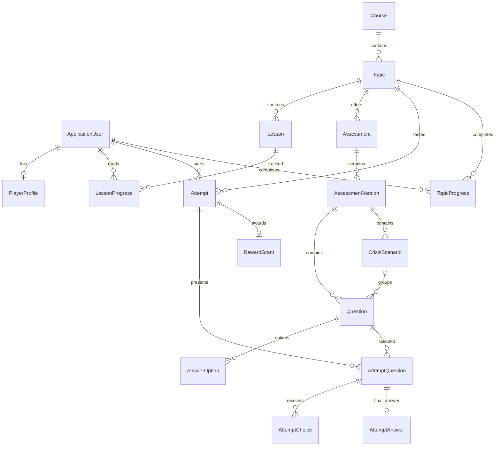

# Модель данных

17 предметных сущностей, 24 таблицы с учётом служебных таблиц Identity и истории миграций.
Идентификаторы — UUID, время — UTC / timestamptz. Пароли сохраняет Identity как хеши.

| Сущность | Назначение |
|---|---|
| ApplicationUser | Учётная запись Identity, email, блокировка, дата создания |
| PlayerProfile | Имя, аватар, суммарный XP и монеты; разряд вычисляется, не хранится отдельно |
| Course | Курс и публикация |
| Topic | Тема, порядок внутри курса и публикация |
| Lesson | Markdown-лекция, порядок и публикация |
| LessonProgress | Составной ключ UserId + LessonId, дата чтения и фактически выданный XP |
| TopicProgress | Составной ключ UserId + TopicId, дата первой победы и первая успешная попытка |
| Assessment | Тема, режим Boss/Crisis и публикация |
| AssessmentVersion | Опубликованная версия банка/сценариев; время вопроса босса и параметры |
| CrisisScenario | Вводный текст, ключ иллюстрации и порядок; относится к версии |
| Question | Формулировка, пояснение; у QTE также ScenarioId |
| AnswerOption | Вариант, порядок, признак правильности |
| Attempt | Пользователь, тема, проверка, версия, сценарий, состояние, даты, дедлайн, счётчики |
| AttemptQuestion | Отобранный вопрос той же версии, порядок, статус, время предъявления и дедлайн |
| AttemptChoice | Все выборы, включая неверные QTE, requestId, время и правильность |
| AttemptAnswer | Один окончательный ответ вопроса попытки |
| RewardGrant | Одна выплата на попытку; FirstPass или RepeatPass, фактические XP и монеты |

## Ограничения

- Нормализованный email уникален, профиль использует идентификатор пользователя как ключ.
- XP, монеты, выданные суммы и счётчики неотрицательны.
- Одна отметка чтения на пользователя и лекцию, одно завершение на пользователя и тему.
- Одна активная попытка на пользователя, включая подготовленный QTE.
- Проверка и попытка относятся к одной теме; попытка и вопросы относятся к одной версии.
- QTE-сценарий принадлежит версии попытки и версии своих вопросов.
- Любой выбор относится именно к своему вопросу попытки и варианту этого вопроса.
- requestId уникален внутри попытки; один вариант конкретного вопроса нельзя списать повторно.
- Первая награда уникальна на пользователя и тему; повторные допустимы, но максимум одна на попытку.
- Награда и первая успешная попытка завершения принадлежат тому же пользователю и теме.
- У варианта SingleChoice не больше одного правильного ответа на вопрос; сервис старта дополнительно проверяет наличие ровно одного и нужное число вариантов.
- История защищена от каскадного удаления.

`AttemptAnswer` хранит окончательный выбор шага; неверные промежуточные действия QTE находятся в `AttemptChoice`.
Без отдельной истории выборов невозможно корректно восстановить заблокированные варианты после обновления страницы.
`TopicProgress` обеспечивает общую первую победу для обоих режимов; прежней уникальности только по AssessmentId для этого недостаточно.

Первое чтение и игровые награды сохраняются атомарно с балансом. Дедлайны хранятся в БД и пересчитываются сервером,
поэтому клиентские часы не могут продлить попытку. Подробные правила — в [trials-and-integration.md](trials-and-integration.md).

Классы содержат и исторические параметры версии: текущие правила 7/5/3 и QTE 4 шага реализованы в игровом сервисе,
а экономика задаётся глобальной секцией Game. Для изменения правил понадобится согласованное изменение сервиса и тестов.
Административного API ещё нет: опубликованные версии следует сохранять неизменными и выпускать новые версии для изменений.
