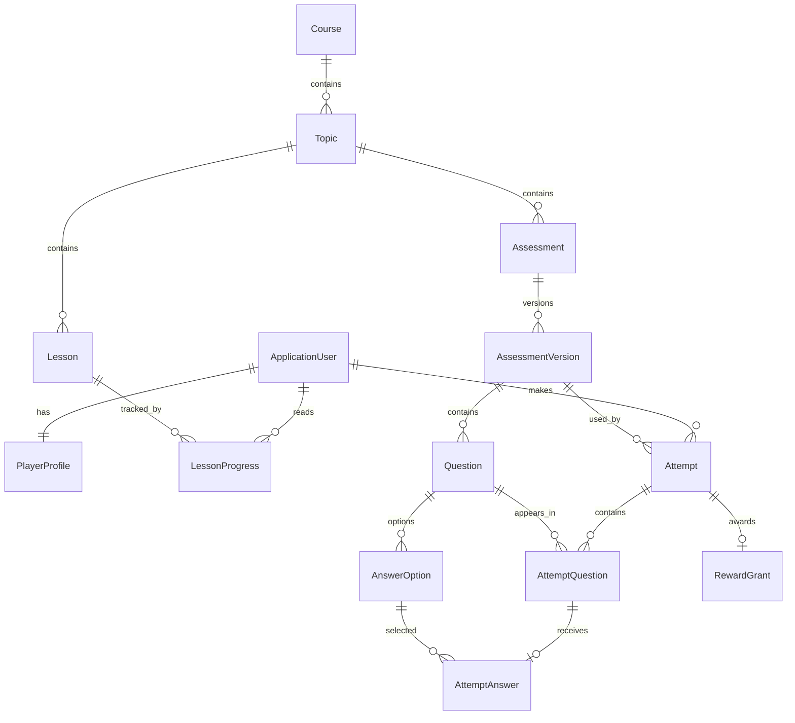

# Модель данных первого коммита

Идентификаторы — Guid/UUID. Даты событий — UTC (`timestamptz`).
Таблицы Identity добавляются библиотекой; пароль хранится только как хеш.

| Сущность | Основные данные |
|---|---|
| ApplicationUser | Email, хеш пароля, блокировка входа, дата создания |
| PlayerProfile | UserId, имя, ключ аватара, XP, монеты |
| Course | Slug, название, описание, публикация |
| Topic | CourseId, название, порядок, публикация |
| Lesson | TopicId, название, Markdown, порядок, публикация |
| LessonProgress | UserId + LessonId, дата прочтения |
| Assessment | TopicId, режим Boss/Crisis, обязательность, публикация |
| AssessmentVersion | Версия, дата публикации, время, порог победы, параметры босса, награда |
| Question | AssessmentVersionId, формулировка, тип SingleChoice, объяснение |
| AnswerOption | QuestionId, вариант, правильность |
| Attempt | UserId, AssessmentId, версия, состояние, результат, даты |
| AttemptQuestion | Попытка, вопрос той же версии, порядок, дедлайн |
| AttemptAnswer | Вопрос попытки, выбранный вариант, правильность, дата |
| RewardGrant | Пользователь, проверка, попытка, основание, XP/монеты |

## Уже закреплено в БД

- Уникальность нормализованного email и одного профиля пользователя.
- Неотрицательные XP, монеты и суммы наград.
- Одна отметка чтения на пользователя и лекцию.
- Уникальный номер версии внутри проверки.
- Не более одного правильного варианта SingleChoice.
- Одна активная попытка пользователя на логическую проверку.
- Согласованность проверки и выбранной версии через составные FK.
- Вопрос попытки принадлежит той же версии, что и попытка.
- Ответ выбирает вариант именно своего вопроса, а не произвольного другого.
- Одна награда на попытку; уникальность UserId + AssessmentId + Reason.
- Награда относится к тому же пользователю и проверке, что и её попытка.
- Запрет каскадного удаления учебной истории.

## Что требуется реализовать вместе с проверкой знаний

Ограничения БД не заменяют правила операции: при публикации нужно проверить наличие
вопросов, минимум двух вариантов, ровно один правильный и достижимый порог победы.
После публикации версию нельзя изменять; для новых вопросов создаётся новая версия.
Эти правила пока не включены в API, так как API редактирования и публикации ещё нет.

Сервер проверяет дедлайн, владельца попытки и допустимость перехода состояния.
Награда выдаётся только за первый успешный результат; состояние попытки, запись награды
и счётчики профиля обновляются одной транзакцией. Текущая схема предотвращает часть
несогласованных записей, но само начисление пока не реализовано.

Сначала все студенты видят один опубликованный курс. Учебные группы, Enrollment,
назначение преподавателя, магазин и лабораторные добавляются при подтверждении требований.
